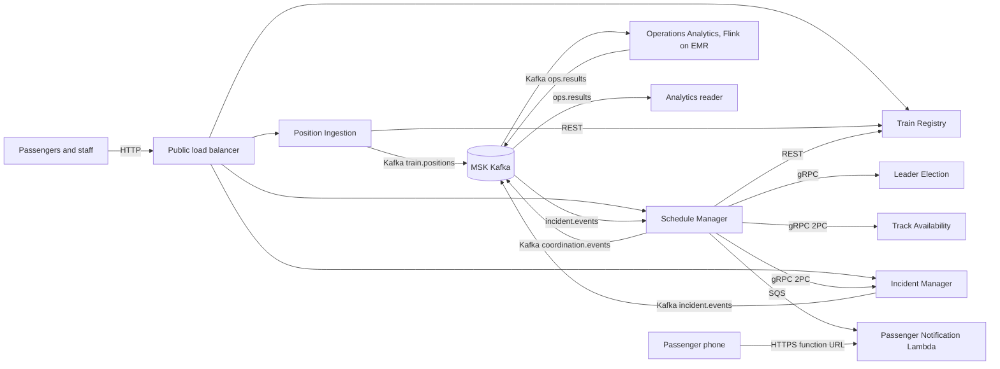

# Railway LineClear

Railway LineClear manages train movements for a railway division, modelled on Indian Railways. Trains report their GPS positions, staff report track incidents, and trains are diverted around blocked sections using two-phase commit, coordinated by an elected duty controller.

"Line clear" is the permission a station gives before a train may enter the next block section. In this system it is the prepare phase of two-phase commit: every station involved must agree before a diversion goes ahead.

The example used throughout: a rail fracture is reported on block section S7 (incident I-45), so train 12951 is diverted through loop line L2 in transaction T-101. Track Availability must reserve L2, Incident Manager must move I-45 to Mitigating, and Schedule Manager must publish revised arrival times. Either all three happen or none do.

## Architecture



| Service | Runs on | Talks through | Storage |
| --- | --- | --- | --- |
| Train Registry | EKS, autoscaled | Public REST | RDS PostgreSQL |
| Position Ingestion | EKS, autoscaled | Public REST in, REST to Train Registry, Kafka out | DynamoDB |
| Incident Manager | EKS, 2 pods | Public REST, gRPC 2PC participant, Kafka out | RDS PostgreSQL |
| Leader Election | EKS, 2 pods | gRPC, Kafka out | DynamoDB lease table |
| Track Availability | EKS, 2 pods | gRPC 2PC participant | RDS PostgreSQL |
| Schedule Manager | EKS, 2 replicas, one leads | Public REST (read-only), Kafka in and out, gRPC coordinator, SQS out | RDS PostgreSQL |
| Passenger Notification | AWS Lambda | SQS trigger, HTTPS function URL | DynamoDB, S3 |
| Operations Analytics | Flink SQL on EMR, plus a reader pod on EKS | Kafka in, Kafka `ops.results` out | DynamoDB, S3 checkpoints |

Communication follows one rule: synchronous calls (REST, gRPC) when the caller needs the answer, asynchronous messages (Kafka, SQS) when it does not.

### Two-phase commit

- Schedule Manager runs two replicas. Each campaigns for the `schedule-coordinator` lease in Leader Election; the holder is the coordinator, and its term is the shift number.
- The coordinator writes PREPARING to its log, asks Track Availability and Incident Manager to prepare, writes COMMIT or ABORT, then retries phase 2 until both acknowledge.
- Participants save their vote before replying and refuse any call with a term lower than the highest they have seen, so a controller that lost its shift cannot change anything.
- A new coordinator reads the log before taking new work and finishes every undecided transaction. A participant that restarts asks the coordinator for the decision. Unknown transactions are presumed aborted.

## Repository layout

| Folder | Contents |
| --- | --- |
| `infra/account` | Terraform: S3 bucket for Terraform state, monthly cost budget |
| `infra/platform` | Terraform: VPC, EKS, RDS, MSK, DynamoDB, ECR, SQS, Lambda functions, S3 buckets, EMR, IAM and Pod Identity roles, the internal load balancer for Loki |
| `infra/argocd` | Terraform: ArgoCD and the root application |
| `gitops/apps` | One ArgoCD Application per component (app of apps) |
| `gitops/cluster-config` | Namespaces, the secret store, the default storage class, secrets copied from Secrets Manager |
| `gitops/kafka-topics` | The Job that creates the Kafka topics |
| `gitops/services` | Kubernetes manifests for each service |
| `gitops/observability` | Grafana dashboards and Prometheus alert rules |
| `services` | Code for the eight services, each with its own Dockerfile |
| `proto/lineclear` | gRPC contracts: participant, track, election |
| `loadtest` | k6 scripts and a GPS simulator |

## Build it from scratch

Tools: Terraform 1.11 or newer, AWS CLI v2, kubectl, Docker, Python 3.11 with uv, k6, grpcurl.

1. **Account stack.** Create `infra/account/terraform.tfvars` (kept out of Git) with `budget_emails = ["you@example.com"]`, then:

   ```bash
   terraform -chdir=infra/account init && terraform -chdir=infra/account apply
   ```

   The state bucket holds its own state. On a new AWS account it does not exist yet: move `backend.tf` aside, apply, put it back and run `terraform -chdir=infra/account init -migrate-state`. Each stack's `backend.tf` names the bucket, which includes the account ID.

2. **Platform stack** (about 20 to 40 minutes, MSK is the slowest):

   ```bash
   terraform -chdir=infra/platform init && terraform -chdir=infra/platform apply
   aws eks update-kubeconfig --name lineclear --region ap-south-1
   ```

3. **Images.** Each service image is tagged with the short ID of the last commit that changed the service, which is the tag `gitops/services/<service>/deployment.yaml` names:

   ```bash
   SERVICE=train-registry
   TAG=$(git log -1 --abbrev=7 --format=%h -- services/$SERVICE)
   URI=$(aws ecr describe-repositories --repository-names lineclear/$SERVICE --query 'repositories[0].repositoryUri' --output text)
   aws ecr get-login-password | docker login --username AWS --password-stdin "${URI%%/*}"
   docker build -t "$URI:$TAG" services/$SERVICE && docker push "$URI:$TAG"
   ```

   Repeat for every service with a Dockerfile. Passenger Notification and the log forwarder are Lambda functions, zipped and deployed by Terraform.

4. **ArgoCD.** ArgoCD then deploys everything in `gitops/` from `main`:

   ```bash
   terraform -chdir=infra/argocd init && terraform -chdir=infra/argocd apply
   kubectl get applications -n argocd
   ```

   All 17 Applications should reach Synced and Healthy. If `kube-prometheus-stack` stays Progressing with no Prometheus pod, the operator started before its resource types existed; restart it with `kubectl rollout restart deployment kube-prometheus-stack-operator -n monitoring`.

Deployments are changed only through Git: commit a new image tag or manifest to `gitops/`, merge to `main`, and ArgoCD applies it. A rollback is a `git revert` of that commit.

## Use it

```bash
ALB=$(kubectl get ingress -n lineclear -o jsonpath='{.items[0].status.loadBalancer.ingress[0].hostname}')
curl -s http://$ALB/api/trains/12951
curl -s http://$ALB/api/positions/12951
curl -s http://$ALB/api/schedule/coordinator
curl -s http://$ALB/api/schedule/diversions
```

Report an incident, which starts a diversion:

```bash
curl -s -X POST http://$ALB/api/incidents -H 'Content-Type: application/json' \
  -d '{"kind": "rail_fracture", "section": "S7", "train_number": "12951", "description": "Rail fracture near the level crossing"}'
```

Staff-only actions (resolving an incident, the coordinator fault switch) need the `X-Staff-Key` header; the key is in Secrets Manager under `lineclear/staff-api-key`.

Passengers read their notices over HTTPS from the Lambda function URL:

```bash
URL=$(terraform -chdir=infra/platform output -raw passenger_notification_url)
curl -s ${URL}notices/12951
```

GPS traffic for a few trains:

```bash
python3 loadtest/gps_simulator.py --base-url http://$ALB --minutes 2
```

## Stream processing

Operations Analytics is a Flink SQL job on EMR. It reads `train.positions`, `incident.events` and `coordination.events`, counts distinct trains per block section in 1-minute event-time windows (plus incidents per section and coordination results), and writes the results to `ops.results`. The reader pod stores them in DynamoDB and serves them to Prometheus.

EMR is off by default to save cost:

```bash
terraform -chdir=infra/platform apply -var enable_emr=true
```

Then submit `services/ops-analytics/flink/start-job.sh` as an EMR step through `script-runner.jar`, with the analytics bucket as its argument. Checkpoints go to S3 every 30 seconds. A plain `terraform apply` removes EMR again.

## Observability

- **Metrics:** Prometheus scrapes every service. Grafana has three dashboards from `gitops/observability`: service health (request rate, errors, p95 per service), cluster health (nodes, pods, autoscalers) and railway operations (duty controller, term, commits and aborts, votes, Flink results).
- **Alerts:** `NoDutyController` (no lease holder for 10 seconds) and `HighServerErrorRate` (over 5% server errors for a minute), shown in Prometheus and Grafana.
- **Logs:** Loki holds logs from every pod (through Grafana Alloy), from Flink on EMR (through Fluent Bit) and from the Passenger Notification Lambda (through a log forwarder). Every log line of a diversion carries its transaction ID:

  ```text
  {app=~".+"} | json | txn_id="T-101"
  ```

Grafana is reached through a port-forward:

```bash
kubectl port-forward -n monitoring svc/kube-prometheus-stack-grafana 3000:80
```

The admin password is in Secrets Manager under `lineclear/grafana/admin`.

## Load test

Position Ingestion and Train Registry scale on CPU (target 60%, 2 to 8 pods). The full test ramps to 60 virtual users, holds the peak for 10 minutes and checks p95 under 500 ms and errors under 1%:

```bash
k6 run -e BASE_URL=http://$ALB loadtest/full-load-test.js
```

`PEAK_VUS` changes the peak; `PROFILE=baseline` runs one user for a minute.

## Tear down

The public load balancer is created by Kubernetes, not Terraform, so the applications go first:

1. Delete the `root` Application, then each service Application, and wait until no `lineclear-public` load balancer is left. Delete the monitoring Applications and their volume claims.
2. `terraform -chdir=infra/argocd destroy`
3. `terraform -chdir=infra/platform destroy`

`infra/account` (state bucket and budget) is kept.
